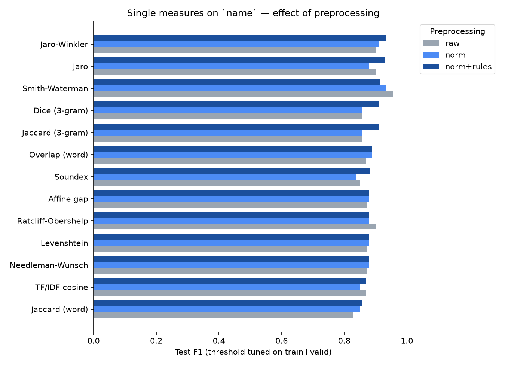
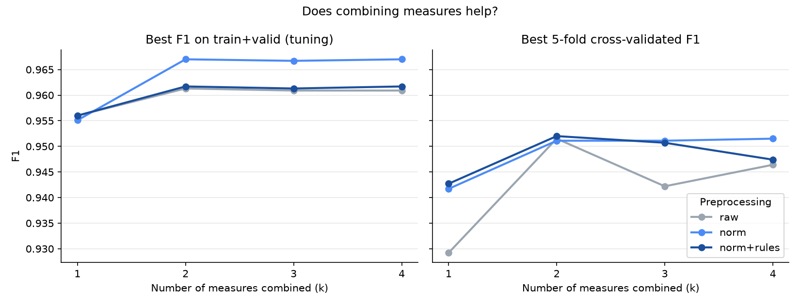
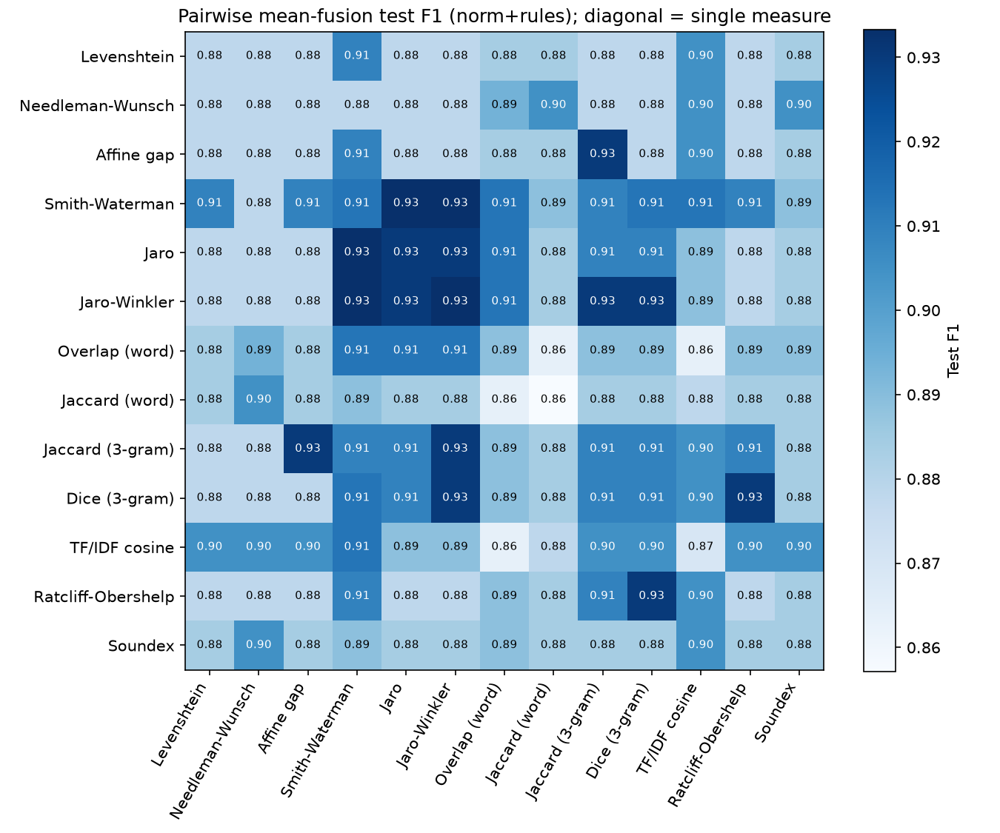

# Home Assignment: String Matching on Fodors-Zagats

**Dataset:** Fodors-Zagats (Magellan data repository): restaurant listings from two guides.
Table A (Fodor's) has 533 rows and Table B (Zagat) has 331. The data comes with **946 labeled pairs**, of which **110 are matches**, split into train (567), valid (190) and test (189, 22 matches).

**Matching attribute:** `name` (restaurant name).

**Code:** `string_matching.py`. It runs end-to-end in about 30 s. Outputs are written to `results/`.

---

## 1. Setup

### Preprocessing (3 variants)
| Variant | What it does | Example |
|---|---|---|
| `raw` | value as stored | `` ` art \ 's delicatessen ' `` |
| `norm` | case folding, strips the dataset's quote/escape artifacts and punctuation, collapses whitespace | `art s delicatessen` |
| `norm+rules` | `norm` + rule-based matching: `&→and`, abbreviation rules, drop stop words (`the`, `restaurant`, `'s`, …) | `art delicatessen` |

### Similarity measures (13, all from the lecture, implemented from scratch)
| Family | Measures |
|---|---|
| Sequence-based | Levenshtein (`1 − d/max len`), Needleman-Wunsch (global, +1/−1/−1), Affine gap (Gotoh: match 2, mismatch −1, open −1, extend −0.5), Smith-Waterman (local), Jaro, Jaro-Winkler (PW = 0.1) |
| Set-based | Overlap coefficient (words), Jaccard (words), Jaccard (3-grams, `#` padding), Sorensen-Dice (3-grams), TF/IDF cosine (idf = log N/N_t over all names in A ∪ B) |
| Similarity-based | Ratcliff-Obershelp (recursive longest common substring) |
| Phonetic | Soundex (slide algorithm), compared as Jaccard of per-word codes |

I checked each implementation against the worked examples on the slides. All of them match: edit sim(David Smiths, Davidd Simth) = 0.67; Jaro(jon, john) = 0.917; Jaro / Jaro-Winkler(Vishwanathan, Vishvnahtan) = 0.847 / 0.908; Ratcliff-Obershelp(MATHEMATICS, MATEMATICA) = 0.857; Soundex(Banarjee) = Soundex(Benerji) = B562.

### Combinations
Each combination is a preprocessing variant plus a set of measures plus a fusion rule:
* k = 1: each of the 13 measures alone.
* k = 2: all 78 pairs, each fused 4 ways: **mean, max, min, product**.
* k = 3 and k = 4: all 286 triples and all 715 quadruples, fused with **mean**.

Across the 3 preprocessing variants this gives **3,978 combinations**.

### Evaluation protocol
* A pair is predicted to be a match when its fused score is at least t. The threshold t is chosen to **maximize F1 on train+valid**. The test set is never used to choose t or to choose the winner.
* Metrics reported: F1 on train+valid, plus precision, recall, F1 and ROC-AUC on test.
* The test set has only 22 matches, so a single pair moves test F1 by about 2 points. I therefore also report **5-fold stratified cross-validated F1** over all 946 pairs (thresholds tuned inside each fold) as a robustness check.

---

## 2. Results

### 2.1 Single measures (`norm`)
| Measure | F1 train+valid | F1 test | F1 5-fold CV |
|---|---|---|---|
| **Overlap (word)** | **0.955** | 0.889 | **0.942** |
| TF/IDF cosine | 0.936 | 0.851 | 0.914 |
| Smith-Waterman | 0.925 | 0.933 | 0.927 |
| Soundex | 0.904 | 0.837 | 0.870 |
| Jaccard (word) | 0.900 | 0.851 | 0.864 |
| Jaccard / Dice (3-gram) | 0.896 | 0.857 | 0.876 |
| Jaro-Winkler | 0.876 | 0.909 | 0.838 |
| Jaro | 0.871 | 0.878 | 0.861 |
| Levenshtein / NW / Affine / Ratcliff-Obershelp | 0.866 | 0.878 | 0.853–0.860 |

* **Token-based measures are the strongest single measures.** Restaurant names vary mostly by *extra words* (`lulu` vs `lulu restaurant-bis-cafe`, `fenix` vs `fenix at the argyle`). Overlap = |A∩B| / min(|A|,|B|) scores those pairs as 1.0. Edit distance penalizes every added character instead.
* **Smith-Waterman** (local alignment) does well for the same reason: it scores the best-matching *substring* and ignores the extra words.
* **Global sequence measures plateau.** Levenshtein, Needleman-Wunsch, affine gap and Ratcliff-Obershelp perform almost identically and make the same mistakes.

### 2.2 Preprocessing
Mean F1 across all combinations: `raw` 0.876, `norm` 0.884, `norm+rules` **0.905** (5-fold CV). Normalization and rules help almost every measure, Soundex and word-Jaccard the most (+4–5 pts). The reason is that the raw strings contain tokens like `` ` `` and `\ 's` that break word sets.

### 2.3 Does combining help?

| k | Best F1 train+valid | Best 5-fold CV F1 |
|---|---|---|
| 1 | 0.956 | 0.943 |
| **2** | **0.967** | **0.952** |
| 3 | 0.967 | 0.951 |
| 4 | 0.967 | 0.952 |

**Going from one measure to two gives about +1 F1 point. Adding a third or fourth measure gives nothing more.**
The best pairs combine one **token-set** measure with one **character-sequence** measure. They complement each other: overlap handles extra or missing words, and Jaro-Winkler / Smith-Waterman handle spelling variants such as `till erman` vs `tillerman`.

On fusion rules (k = 2, best CV F1): max 0.952, mean 0.951, product 0.951, min 0.946. `min` is the weakest because it lets the worse of the two measures veto the pair.

### 2.4 Top combinations (ranked by train+valid F1)
| # | Prep | Combination | Fusion | t | F1 tr+val | P test | R test | F1 test | F1 CV |
|---|---|---|---|---|---|---|---|---|---|
| 1 | norm | Jaro + Jaro-Winkler + Overlap(word) + TF/IDF | mean | 0.726 | 0.967 | 0.875 | 0.955 | 0.913 | 0.952 |
| **2** | **norm** | **Jaro-Winkler + Overlap(word)** | **mean** | **0.773** | **0.967** | **0.875** | **0.955** | **0.913** | **0.951** |
| 3 | norm | Jaro-Winkler + Overlap(word) + TF/IDF | mean | 0.729 | 0.967 | 0.875 | 0.955 | 0.913 | 0.951 |
| 4 | norm+rules | Smith-Waterman + Jaccard(word) | max | 1.000 | 0.962 | 0.875 | 0.955 | 0.913 | 0.952 |
| 5 | raw | Smith-Waterman + Overlap(word) | max | 0.882 | 0.961 | 0.880 | 1.000 | 0.936 | 0.952 |

Full table: `results/all_combinations.csv`.

---

## 3. Answer: best combination for `name`

> **Normalization, then mean(Jaro-Winkler, Overlap coefficient on words), with match threshold 0.773.**
> F1 = **0.967** on train+valid, **0.913** on the held-out test set (P 0.875, R 0.955, AUC 0.994), and **0.951** with 5-fold cross-validation.

Rows 1–3 in the table above score the same within 0.0004 F1. I picked the **2-measure** version because it is simpler and adding measures does not improve it. It is also one sequence-based plus one set-based measure, which matches the lecture's advice to combine TF-IDF/set measures with edit-style measures.

A caution on cherry-picking: raw Smith-Waterman alone reaches test F1 0.957 (recall 1.0), but only 0.926 on train+valid and 0.927 with CV. It looks best on the test set because the test set is small. Choosing a method by its test score would be overfitting.

---

## 4. Error analysis: what `name` alone cannot fix
The best method makes 4 errors on the test set (`results/best_errors_test.csv`):

| Fodor's | Zagat | Truth | Why it fails |
|---|---|---|---|
| tillerman | till erman the | match | Word split breaks the word overlap, and the extra "the" lowers Jaro-Winkler |
| cha cha cha | cha cha cha 's | non-match | Names are nearly identical but the restaurants are different |
| steak house | sparks steak house | non-match | All words of one name appear in the other, so overlap = 1 |
| tommy tang 's | tommy 's | non-match | Same as above |

Non-matches with identical or near-identical names also appear across the full data: `teresa's` / `teresa's` (score 1.0, different restaurants), `sea grill` / `mesa grill`, `jimmy's` / `tommy's`. **No string measure on `name` can separate these.** The remaining errors need other attributes (`addr`, `phone`, `city`). The F1 ≈ 0.95 reached here is close to the ceiling for this attribute alone.

## 5. Takeaways
1. **Preprocessing matters.** Normalizing and applying rules adds about 2–3 F1 points on average, and it is cheap.
2. **Pick measures that fit the variation in the data.** Restaurant names differ by extra or missing words, so word-overlap and local alignment (Smith-Waterman) work better than global edit distance.
3. **Combine complementary families.** One set-based plus one sequence-based measure gives the best result. Adding more measures does not help further.
4. **Tune thresholds on training data and check with CV.** A 22-match test set is too small to rank 4,000 combinations by itself.

## Files
| File | Contents |
|---|---|
| `string_matching.py` | All measures, combinations, evaluation, charts |
| `results_log.txt` | Console summary (rankings per preprocessing, per k, per fusion) |
| `results/all_combinations.csv` | All 3,978 combinations with metrics |
| `results/single_measures.csv` | The 13 measures × 3 preprocessing variants |
| `results/pair_scores_norm_rules.csv` | Per-pair scores of every measure |
| `results/best_errors_test.csv`, `hard_matches.csv`, `hard_nonmatches.csv` | Error analysis |
| `results/fig1–fig4*.png` | Charts |
